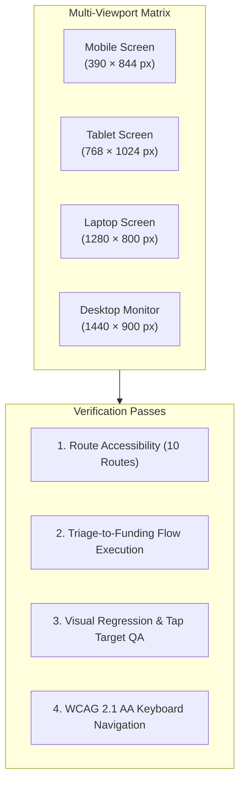

# LifeEvent AI: End-to-End (E2E) & Multi-Viewport QA

**Document Version:** 2.0  
**Status:** Approved Architectural Baseline  
**Framework:** Playwright Test 1.40+ & Chromium / WebKit  
**Execution Command:** `npx playwright test`  
**Product:** LifeEvent AI — AI-Powered Financial Journey Operating System

---

## 1. End-to-End Testing Strategy

End-to-End tests verify complete customer workflows across the Next.js frontend, ensuring seamless visual ergonomics, accessibility compliance, and flawless rendering on mobile devices during hospital triage.



---

## 2. Route Verification Checklist

All ten user-facing Next.js routes must render with zero console errors and clean HTTP 200 responses:

| Route | Viewport Check | Mandatory Visual Verification Criteria |
| :--- | :---: | :--- |
| `/` | All 4 | Landing page: hospital-counter crisis story and 5 questions render clearly. |
| `/intake` | All 4 | Voice dictation button visible; both one-click scenario loaders populate form. |
| `/journey/[id]` | All 4 | Honest gap range card renders (Low–Expected–High); pinned action visible. |
| `/journey/[id]/coverage` | All 4 | Itemized table renders; clicking item opens verbatim policy quote modal. |
| `/journey/[id]/funding` | All 4 | Sized bridge credit offers render; Paytm UPI instant deposit button active. |
| `/documents` | All 4 | Interactive Verhoeff playground formats 12 digits; document status list. |
| `/counselor` | Desktop/Lap | Queue table renders active journeys, readiness scores, and TPA queries. |
| `/for-hospitals` | All 4 | B2B SaaS pilot proposition (₹25,000/mo) and trial request form submit cleanly. |
| `/how-it-works` | All 4 | 5-step journey infographic and dual-engine architecture explainer. |
| `/privacy` | All 4 | DPDP Act charter and working "Erase My Data" hard delete tool. |

---

## 3. Multi-Viewport Visual QA Standards

1. **Zero Horizontal Overflow:** Page body width must not exceed viewport width ($W \le 100\text{vw}$) on mobile devices (390px).
2. **Minimum Tap Targets:** All clickable buttons, inputs, and tabs must maintain a minimum bounding box of **$44 \times 44\text{ px}$** on mobile viewports to prevent mis-clicks by trembling hands.
3. **Devanagari Font Rendering:** Hindi and Marathi script rendered using `Noto Sans Devanagari` must not clip diacritics (matras) or truncate text blocks.
4. **Motion Safety:** When `prefers-reduced-motion` is enabled, all CSS transitions and animations must immediately disable.

---

## 4. Playwright Test Script (`frontend/tests/e2e.spec.ts`)

```typescript
import { test, expect } from '@playwright/test';

const VIEWPORTS = [
  { name: 'desktop', width: 1440, height: 900 },
  { name: 'laptop',  width: 1280, height: 800 },
  { name: 'tablet',  width: 768,  height: 1024 },
  { name: 'mobile',  width: 390,  height: 844 },
];

for (const vp of VIEWPORTS) {
  test(`Verify Emergency Flow on ${vp.name} (${vp.width}x${vp.height})`, async ({ page }) => {
    await page.setViewportSize({ width: vp.width, height: vp.height });

    // 1. Visit Intake page
    await page.goto('http://localhost:3000/intake');
    await expect(page.locator('h1')).toContainText('Emergency Admission');

    // 2. Click cardiac scenario loader
    await page.click('button:has-text("Load Cardiac Scenario")');
    await expect(page.locator('input[name="patient_name"]')).toHaveValue('Ramesh Sharma');

    // 3. Submit intake
    await page.click('button:has-text("Start Living Journey")');

    // 4. Assert navigation to living journey dashboard
    await expect(page).toHaveURL(/.*\/journey\/demo-journey-cardiac-01/);
    await expect(page.locator('text=Next Best Action')).toBeVisible();

    // 5. Verify no horizontal overflow
    const bodyWidth = await page.evaluate(() => document.body.scrollWidth);
    expect(bodyWidth).toBeLessThanOrEqual(vp.width);
  });
}
```

