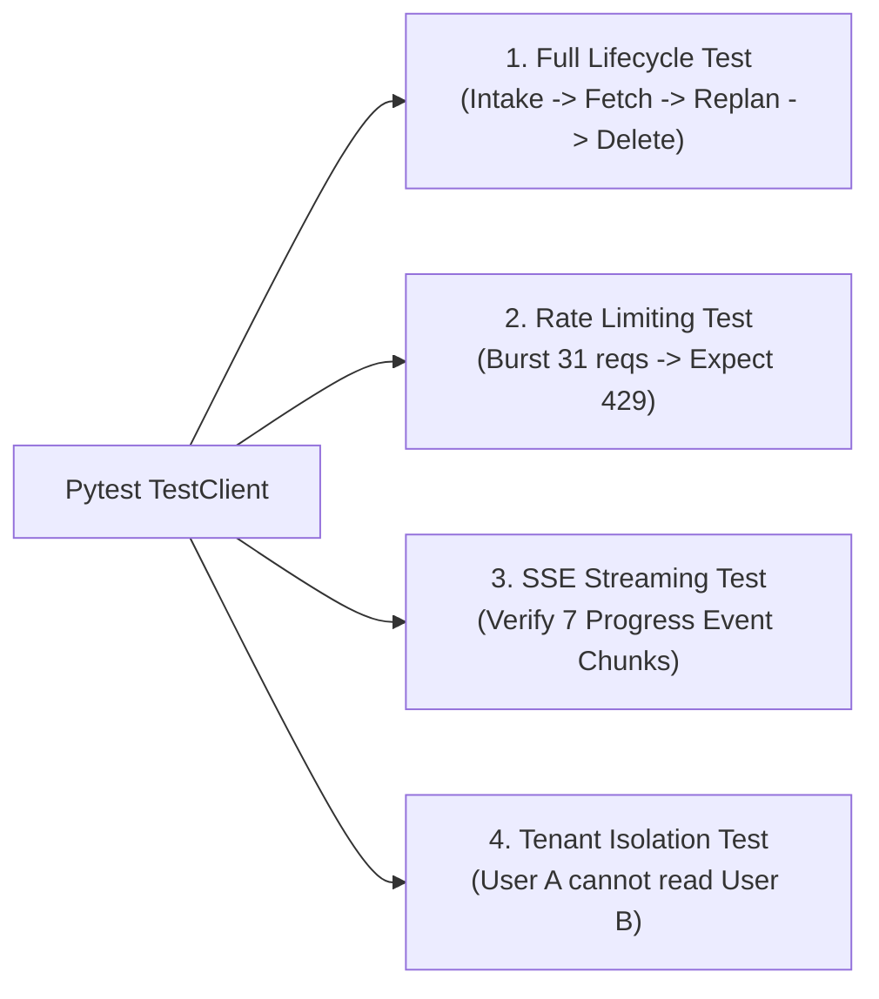

# LifeEvent AI: Integration Testing Specification

**Document Version:** 2.0  
**Status:** Approved Architectural Baseline  
**Framework:** Pytest + FastAPI `TestClient` (HTTPX)  
**Execution Command:** `pytest backend/tests/test_api_routes.py -v`  
**Product:** LifeEvent AI — AI-Powered Financial Journey Operating System

---

## 1. Integration Testing Scope

Integration tests evaluate interaction between the FastAPI application layer, routing middleware, Pydantic serialization, business logic engines, and database persistence.



---

## 2. Integration Test Suites (`backend/tests/test_api_routes.py`)

### 2.1 Journey Lifecycle Integration Test
```python
import pytest
from fastapi.testclient import TestClient
from backend.app.main import app

client = TestClient(app)

def test_full_journey_lifecycle():
    # 1. Health check
    health_res = client.get("/api/health")
    assert health_res.status_code == 200
    assert health_res.json()["status"] == "healthy"

    # 2. Ingest emergency intake
    intake_payload = {
        "patient_name": "Ramesh Kumar",
        "relation": "father",
        "hospital_name": "Ruby Hall Clinic",
        "condition_description": "Acute chest pain, emergency angioplasty recommended.",
        "urgency": "critical",
        "estimated_amount": 420000.0,
        "allowed_room_rent": 5000.0,
        "actual_room_rent": 8500.0,
        "stay_days": 4,
        "sum_insured": 500000.0,
        "copay_percent": 10.0,
        "aadhaar_number": "234123412346",
        "is_demo": True
    }
    
    create_res = client.post("/api/journey/intake", json=intake_payload)
    assert create_res.status_code == 200
    journey = create_res.json()
    journey_id = journey["id"]
    
    # Assert Aadhaar masked in response
    assert journey["intake"]["aadhaar_number"] == "XXXX-XXXX-2346"
    assert "gap" in journey
    assert journey["gap"]["gap_expected"] > 0

    # 3. Fetch Journey by ID
    fetch_res = client.get(f"/api/journey/{journey_id}")
    assert fetch_res.status_code == 200
    assert fetch_res.json()["id"] == journey_id

    # 4. Trigger TPA Query Re-plan
    replan_res = client.post(f"/api/journey/{journey_id}/replan")
    assert replan_res.status_code == 200
    updated_journey = replan_res.json()
    assert updated_journey["current_stage"] == "tpa_query_pending"
    assert "ECG" in updated_journey["next_best_action"]

    # 5. Permanent DPDP Hard Delete
    delete_res = client.delete(f"/api/journey/{journey_id}")
    assert delete_res.status_code == 200
    assert delete_res.json()["status"] == "success"

    # 6. Verify subsequent lookup returns 404
    after_delete_res = client.get(f"/api/journey/{journey_id}")
    assert after_delete_res.status_code == 404
```

---

### 2.2 Rate Limiting Integration Test (`slowapi`)
```python
def test_intake_rate_limiting():
    """
    Asserts that bursting 31 rapid intake requests triggers an HTTP 429 Too Many Requests response.
    """
    intake_payload = {
        "patient_name": "Test Burst",
        "hospital_name": "Test Hospital",
        "condition_description": "Test Condition",
        "is_demo": True
    }

    # Fire 30 requests (allowed)
    for _ in range(30):
        res = client.post("/api/journey/intake", json=intake_payload)
        assert res.status_code in [200, 422]

    # The 31st request must trigger 429
    blocked_res = client.post("/api/journey/intake", json=intake_payload)
    assert blocked_res.status_code == 429
    assert "Rate limit exceeded" in blocked_res.text
```

