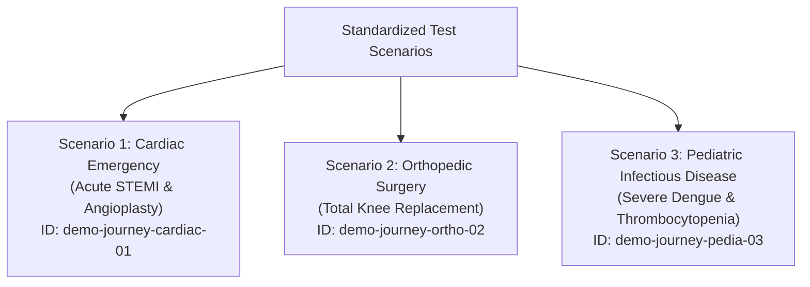

# LifeEvent AI: Synthetic Test Scenarios & Fixture Specifications

**Document Version:** 2.0  
**Status:** Approved Architectural Baseline  
**Data Policy:** Strictly Synthetic Data (Zero Real Citizen PII)  
**Product:** LifeEvent AI — AI-Powered Financial Journey Operating System

---

## 1. Test Scenario Catalog

LifeEvent AI uses three standardized synthetic test scenarios to benchmark system behavior across high-stress medical and financial conditions:

---

## 2. Detailed Scenario Specifications

### Scenario 1: Cardiac Emergency (`demo-journey-cardiac-01`)
- **Patient:** Ramesh Sharma, Age 58, Male (Relation: Father)
- **Hospital:** Ruby Hall Clinic, Pune
- **Condition:** Acute ST-Elevation Myocardial Infarction (STEMI), Emergency Coronary Angioplasty with Drug-Eluting Stents
- **Urgency:** `critical`
- **Language:** Hindi / English
- **Financial Inputs:**
  - Hospital Estimate: ₹4,20,000
  - Allowed Room Rent: ₹5,000/day (1% of ₹5,00,000 SI)
  - Actual Room Rent: ₹8,500/day (ICU/Deluxe)
  - Stay Days: 4 days
  - Sum Insured: ₹5,00,000
  - Co-pay: 10%
  - Aadhaar: `2341 2341 2346` (Valid Verhoeff → Masks to `XXXX-XXXX-2346`)
- **Expected Financial Outputs:**
  - Non-payable consumables (10%): ₹42,000
  - Room-rent proportional deduction: ₹49,350
  - Co-pay amount: ₹32,040
  - **Honest Gap Range:** ₹87,600 (Low) — ₹99,600 (Expected) — ₹120,600 (High)
- **Asynchronous TPA Query Trigger:**
  - Insurer raises query: *"Submit first casualty admission ECG strip and doctor notes to rule out pre-existing ischemic disease."*
  - Re-plan action: Prepend urgent task to checklist; set `current_stage = "tpa_query_pending"`.

---

### Scenario 2: Orthopedic Joint Replacement (`demo-journey-ortho-02`)
- **Patient:** Sunita Patil, Age 62, Female (Relation: Mother)
- **Hospital:** Sancheti Hospital, Pune
- **Condition:** Severe Bilateral Osteoarthritis, Unilateral Total Knee Replacement (TKR)
- **Urgency:** `urgent`
- **Language:** Marathi / English
- **Financial Inputs:**
  - Hospital Estimate: ₹2,80,000
  - Allowed Room Rent: ₹4,000/day
  - Actual Room Rent: ₹4,500/day (Single Private AC)
  - Stay Days: 5 days
  - Sum Insured: ₹4,00,000
  - Co-pay: 0%
  - Implant Cap in Policy: ₹85,000 under Clause 3.2
- **Expected Financial Outputs:**
  - Non-payables: ₹28,000
  - Room-rent penalty: ₹3,125
  - Implant sub-limit excess: ₹15,000
  - **Honest Gap Range:** ₹41,000 (Low) — ₹46,125 (Expected) — ₹55,000 (High)

---

### Scenario 3: Pediatric Infectious Disease (`demo-journey-pedia-03`)
- **Patient:** Aarav Joshi, Age 7, Male (Relation: Son)
- **Hospital:** Bharati Hospital, Pune
- **Condition:** Severe Dengue Hemorrhagic Fever, Severe Thrombocytopenia (Platelet transfusion required)
- **Urgency:** `critical`
- **Language:** English
- **Financial Inputs:**
  - Hospital Estimate: ₹1,10,000
  - Allowed Room Rent: ₹3,000/day
  - Actual Room Rent: ₹3,000/day (Twin Sharing)
  - Stay Days: 6 days
  - Sum Insured: ₹3,00,000
  - Co-pay: 0%
- **Expected Financial Outputs:**
  - Room-rent penalty: ₹0 (Actual $\le$ Allowed)
  - Non-payables & Consumable kits: ₹18,500 (Heavy consumable usage for IV cannulas/platelet kits)
  - **Honest Gap Range:** ₹15,000 (Low) — ₹18,500 (Expected) — ₹24,000 (High)

