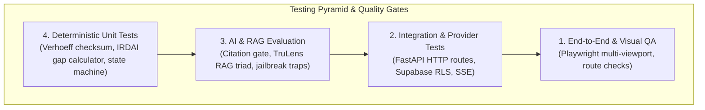

# LifeEvent AI: Quality Assurance & Testing Strategy

**Document Version:** 2.0  
**Status:** Approved Architectural Baseline  
**Product:** LifeEvent AI — AI-Powered Financial Journey Operating System  
**Test Frameworks:** Pytest (Backend) / Playwright (E2E & Visual) / TruLens Methodology (AI Eval)

---

## 1. Quality Assurance Philosophy

LifeEvent AI operates at the intersection of emergency healthcare and financial liabilities. Software defects here can lead to medical delays, financial distress, or PII leaks.

Our testing strategy enforces a **multi-layered testing pyramid**:

---

## 2. Test Suites Summary

| Test Layer | Directory / Command | Suites / Scope | Minimum Pass Target | CI Enforcement |
| :--- | :--- | :--- | :--- | :--- |
| **Unit Testing** | `pytest backend/tests/test_aadhaar.py` `pytest backend/tests/test_gap.py` `pytest backend/tests/test_state_machine.py` | Aadhaar Verhoeff validation, IRDAI room-rent math, task state transition rules | 100% (Zero tolerance for math/PII failures) | Blocking pre-commit and PR merge gate |
| **Citation & AI Testing**| `pytest backend/tests/test_citation.py` `pytest backend/tests/test_ai_evaluation.py` | Verbatim quote matching, planted hallucination traps, schema enforcement | 100% citation pass rate on verified claims | Blocking merge gate |
| **Graph & Flow Testing** | `pytest backend/tests/test_graph.py` | LangGraph StateGraph pipeline execution end-to-end | 100% pass | Blocking merge gate |
| **Integration Testing**| `pytest backend/tests/test_api_routes.py` | FastAPI route contracts, rate limits, `sanitize_logs()`, DPDP hard delete | 100% pass | Blocking merge gate |
| **End-to-End UI Testing**| `npx playwright test` | Multi-viewport screenshot verification (1440/1280/768/390), voice dictation mock | Zero layout shifts, no horizontal scrolls | Staging deploy gate |

---

## 3. Strict Pre-Commit & CI Quality Rules

1. **Deterministic Math Invariance:** Any code change modifying `gap_calculator.py` must update `test_gap.py` assertions and PRD acceptance criteria in the exact same pull request.
2. **Zero PII Leakage Regression:** Tests must assert that output payloads contain zero 12-digit unmasked sequences (`tests/test_aadhaar.py`).
3. **Planted Hallucination Resistance:** The citation gate must catch and reject the synthetic `"Clause 9.9 Luxury Living Claim"` with `likely_covered: 0`.
4. **Clean Builds:** `npm run build` in `frontend/` must complete with zero TypeScript type errors.

