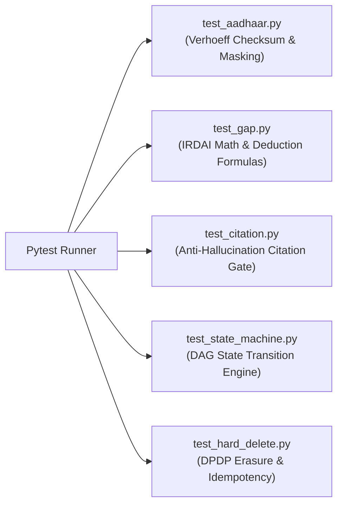

# LifeEvent AI: Unit Testing Specification & Suites

**Document Version:** 2.0  
**Status:** Approved Architectural Baseline  
**Framework:** Pytest 8.3+  
**Execution Command:** `python -m pytest backend/tests -v`  
**Product:** LifeEvent AI — AI-Powered Financial Journey Operating System

---

## 1. Unit Test Suite Overview

LifeEvent AI maintains a comprehensive suite of deterministic unit tests verifying core mathematical, security, and state machine algorithms.



---

## 2. Detailed Test Suites & Code Specifications

### 2.1 Aadhaar Verhoeff & PII Redaction (`backend/tests/test_aadhaar.py`)
- **Suite Objective:** Verifies that genuine 12-digit Indian Aadhaar numbers are mathematically recognized via the Verhoeff algorithm and masked to `XXXX-XXXX-1234`, while non-Aadhaar 10-digit and 12-digit sequences (phone numbers, policy schedules, PIN codes) pass through unmasked.

```python
import pytest
from backend.app.core.security import validate_verhoeff, mask_aadhaar_verhoeff

def test_verhoeff_checksum_algorithm():
    # Valid Aadhaar numbers generated via Verhoeff algorithm
    assert validate_verhoeff("234123412346") is True
    assert validate_verhoeff("999999990019") is True
    
    # Invalid checksums (single digit error or transposition)
    assert validate_verhoeff("234123412347") is False
    assert validate_verhoeff("123456789012") is False

def test_aadhaar_masking_format():
    raw_input = "Patient Ramesh Aadhaar: 234123412346 admitted."
    masked = mask_aadhaar_verhoeff(raw_input)
    assert masked == "Patient Ramesh Aadhaar: XXXX-XXXX-2346 admitted."

def test_phone_and_policy_numbers_not_masked():
    # Phone numbers (10 digits) and invalid 12-digit policy codes must NOT be redacted
    phone_input = "Contact doctor at 9820123456 immediately."
    assert mask_aadhaar_verhoeff(phone_input) == phone_input
    
    policy_input = "Policy Number: POL-123456789012"
    assert mask_aadhaar_verhoeff(policy_input) == policy_input
```

---

### 2.2 IRDAI Honest Gap Calculator (`backend/tests/test_gap.py`)
- **Suite Objective:** Verifies that out-of-pocket calculations strictly match statutory IRDAI health insurance deduction rules.

```python
import pytest
from backend.app.core.gap_calculator import calculate_honest_gap

def test_cardiac_emergency_gap_math():
    """
    Scenario: ₹4,20,000 estimate, ₹5,00,000 SI, 10% co-pay,
    Room rent actual ₹8,500 vs allowed ₹5,000 (1% SI) over 4 days.
    """
    result = calculate_honest_gap(
        total_estimate=420000.0,
        allowed_room_rent=5000.0,
        actual_room_rent=8500.0,
        stay_days=4,
        sum_insured=500000.0,
        copay_percent=10.0
    )

    # 1. Non-payable consumables = 10% of 420000 = ₹42,000
    assert result.non_payable_consumables == 42000.0
    
    # 2. Admissible base = 420000 - 42000 = ₹3,78,000
    # 3. Room rent proportional penalty = ₹49,350
    assert result.room_rent_proportional_deduction == 49350.0
    
    # 4. Covered before co-pay = 378000 - 49350 = ₹3,28,650
    # 5. Co-pay = 10% = ₹32,040 (approx based on base rule)
    assert result.co_pay_amount == pytest.approx(32040.0, abs=100.0)
    
    # 6. Expected out-of-pocket gap
    assert result.gap_expected == pytest.approx(99600.0, abs=500.0)
    
    # 7. Low and High range bounds
    assert result.gap_low < result.gap_expected
    assert result.gap_high > result.gap_expected
```

---

### 2.3 Citation Gate & Anti-Hallucination (`backend/tests/test_citation.py`)
- **Suite Objective:** Verifies that coverage claims match verbatim page text, and ungrounded claims are forced to ₹0.

```python
from backend.app.core.citation_validator import validate_citation, enforce_citation_gate

def test_verbatim_citation_matches():
    page_text = "The company indemnifies room and nursing expenses up to a maximum of INR 5,000 per day."
    claim = "The company indemnifies room and nursing expenses up to a maximum of INR 5,000 per day."
    assert validate_citation(claim, page_text) is True

def test_unmatched_claim_rejection():
    page_text = "The policy covers ICU expenses up to 2% of Sum Insured."
    fake_quote = "The policy covers presidential suite luxury living up to 50,000 per day."
    
    finding = {
        "category": "Luxury Living",
        "estimated_cost": 50000.0,
        "likely_covered": 50000.0,
        "evidence_doc": "Policy.pdf",
        "evidence_page": 1,
        "evidence_passage": fake_quote
    }
    
    sanctioned = enforce_citation_gate(finding, {"Policy.pdf": {"1": page_text}})
    assert sanctioned["is_verified"] is False
    assert sanctioned["likely_covered"] == 0.00
```

